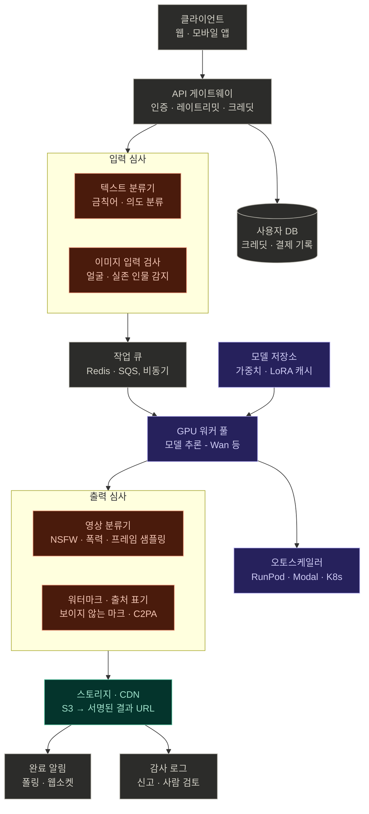

# AI 영상 생성 서비스 아키텍처

> 다이어그램 재현용 원본. 모델·VRAM·가격은 `ai_video_models_guide.md` 참고.

---

## 1. 다이어그램 구조 (위 → 아래)

```
                    ┌─────────────────────┐
                    │     클라이언트        │
                    │    웹 · 모바일 앱     │
                    └──────────┬──────────┘
                               ↓
                    ┌─────────────────────┐      ┌─────────────────┐
                    │   API 게이트웨이      │ ───→ │    사용자 DB     │
                    │ 인증·레이트리밋·크레딧 │      │ 크레딧·결제 기록 │
                    └──────────┬──────────┘      └─────────────────┘
                               ↓
   ┌ 입력 심사 ─────────────────────────────────────────────────────┐
   │  ┌───────────────────────┐    ┌───────────────────────────┐    │
   │  │     텍스트 분류기       │    │     이미지 입력 검사        │    │
   │  │   금칙어 · 의도 분류    │    │   얼굴 · 실존 인물 감지     │    │
   │  └───────────────────────┘    └───────────────────────────┘    │
   └───────────────────────────────┬────────────────────────────────┘
                                   ↓
                    ┌─────────────────────┐
                    │       작업 큐        │
                    │  Redis · SQS, 비동기  │
                    └──────────┬──────────┘
                               ↓
 ┌─────────────────┐  ┌─────────────────────┐  ┌───────────────────┐
 │    모델 저장소    │→ │     GPU 워커 풀      │→ │    오토스케일러     │
 │ 가중치·LoRA 캐시  │  │  모델 추론 (Wan 등)   │  │ RunPod·Modal·K8s  │
 └─────────────────┘  └──────────┬──────────┘  └───────────────────┘
                                 ↓
   ┌ 출력 심사 ─────────────────────────────────────────────────────┐
   │  ┌───────────────────────┐    ┌───────────────────────────┐    │
   │  │      영상 분류기        │    │    워터마크 · 출처 표기     │    │
   │  │ NSFW·폭력·프레임 샘플링 │    │   보이지 않는 마크 · C2PA   │    │
   │  └───────────────────────┘    └───────────────────────────┘    │
   └───────────────────────────────┬────────────────────────────────┘
                                   ↓
 ┌─────────────────┐  ┌─────────────────────┐  ┌───────────────────┐
 │     완료 알림     │← │    스토리지 · CDN     │→ │     감사 로그       │
 │  폴링 · 웹소켓    │  │ S3 → 서명된 결과 URL  │  │  신고 · 사람 검토   │
 └─────────────────┘  └─────────────────────┘  └───────────────────┘
```

### 색상 범례
| 색 | 의미 | 해당 박스 |
|---|---|---|
| 코랄 (#993C1D 계열) | 심사 · 필터 | 텍스트 분류기, 이미지 입력 검사, 영상 분류기, 워터마크·출처 표기 |
| 퍼플 (#534AB7 계열) | 추론 | 모델 저장소, GPU 워커 풀, 오토스케일러 |
| 틸 (#0F6E56 계열) | 전달 | 스토리지 · CDN |
| 그레이 (#5F5E5A 계열) | 공통 인프라 | 클라이언트, API 게이트웨이, 사용자 DB, 작업 큐, 완료 알림, 감사 로그 |

### Mermaid 버전 (HTML에서 바로 렌더링 가능)


---

## 2. 핵심 명제

- 모델은 전체 그림에서 **보라색 박스 하나**뿐. 나머지는 전부 "모델을 안전하고 수익성 있게 돌리기 위한" 레이어.
- 모델 가중치 안에는 콘텐츠 필터가 없음. 제한은 **빨간 박스 4개(서빙 레이어)** 가 담당.
- 실제 개발·운영 공수는 모델보다 필터 레이어와 GPU 비용 관리에서 발생.

---

## 3. 단계별 설명

### 3-1. 클라이언트 → API 게이트웨이
- 요청을 받으면 바로 처리하지 않고 **작업 ID만 발급**하고 큐에 넣음
- 게이트웨이 역할: 인증(JWT/세션), 레이트 리밋, 크레딧 잔액 확인 및 선차감, 요청 로깅
- 사용자 DB: 계정, 크레딧 잔액, 결제 이력, 생성 이력

### 3-2. 입력 심사 (요청 시점, 생성 전)

**텍스트 분류기**
- 1단계: 정규식·사전 기반 금칙어 매칭 — 싸고 빠름, 명백한 것만 거름
- 2단계: 소형 분류 모델로 카테고리별 점수 (성적, 폭력, 미성년자, 실존 인물, 정치 등)
  - 후보: OpenAI Moderation API, Llama Guard, ShieldGemma, 직접 파인튜닝한 BERT/DeBERTa
- 애매 구간 처리: 거부 대신 "순화된 프롬프트로 재작성"하는 서비스도 많음
- 다국어(한국어) 대응과 임계값 튜닝이 실무 난점

**이미지 입력 검사** (이미지→영상, 레퍼런스 영상일 때)
- 얼굴 검출 → 유명인 임베딩 DB 대조
- 연령 추정 모델 (미성년자 차단)
- 이미지 자체 NSFW 분류
- xAI Grok이 2026년 1월 이후 사실상 다시 세운 부분

### 3-3. 작업 큐
- 영상 생성은 호출당 수십 초~수 분, GPU 메모리 통째로 점유 → 동기 응답 불가
- Redis (BullMQ/Celery), RabbitMQ, SQS 등
- 우선순위(유료 티어 우선), 재시도, 타임아웃, 데드레터 큐

### 3-4. GPU 워커 풀 (추론)

**워커 내부**
- 모델은 워커 기동 시 **1회 로드 후 상주** (요청마다 로드 X)
- 실행 방식 3가지:
  1. Diffusers 파이프라인을 파이썬으로 래핑 (서비스 백엔드 표준)
  2. ComfyUI 헤드리스 모드 — 워크플로 JSON을 API로 전달 (LoRA·업스케일·보간 노드 활용)
  3. NVIDIA Triton 등 추론 서버 — 배치 처리, 프로덕션용

**모델 저장소**
- 가중치·LoRA를 네트워크 볼륨(또는 S3 + 로컬 캐시)에 보관
- 없으면 워커가 뜰 때마다 수십 GB 다운로드 → 콜드스타트 수 분

**오토스케일러**
- 큐 길이 기준으로 워커 수 조절
- RunPod Serverless / Modal: 0대까지 축소 가능, 콜드스타트 1~2분 → 최소 1대 상시 유지로 타협
- K8s + KEDA: 자체 클러스터일 때

**최적화 (비용 직결)**
- FP8 / GGUF 양자화 → VRAM 절반
- TeaCache, MagCache → 디노이징 스텝 일부 생략
- torch.compile → 커널 최적화
- 디스틸 모델 (Lightning LoRA 등 4~8스텝) → 10분 → 1분 이내

### 3-5. 출력 심사 (생성 후, 저장 전)

**영상 분류기**
- 전체 프레임 검사는 비쌈 → **초당 1프레임 샘플링** → 이미지 NSFW/폭력 분류기 (CLIP 기반 또는 전용 모델)
- 한 프레임이라도 임계값 초과 시 전체 반려
- 역할: 프롬프트는 정상인데 모델이 엉뚱하게 그린 경우 포착

**워터마크 · 출처 표기**
- 보이지 않는 워터마크 (SynthID 계열)
- C2PA 메타데이터 ("AI 생성물" 출처 체인)
- EU AI법, 한국 AI기본법 모두 표시 요구 방향 → 선택이 아닌 필수

### 3-6. 전달 · 운영

**스토리지 · CDN**
- S3 호환 스토리지 → CDN → **서명된 URL** (만료 시간 포함) 발급
- 보관 기간 정책 (예: 7일 후 자동 삭제)

**완료 알림**
- 클라이언트가 작업 ID로 폴링, 또는 웹소켓/SSE 푸시
- 모바일은 푸시 알림

**감사 로그**
- 모든 요청의 프롬프트·심사 점수·결과·사용자 ID 보관
- 신고 접수 → 사람 검토 큐
- 과잉 차단(false positive)과 누락(false negative) 양쪽을 수집 → 분류기 재학습 데이터 → **운영의 핵심 루프**

---

## 4. 모델 외 서비스 레이어 체크리스트

| 영역 | 항목 |
|---|---|
| 계정 | 인증, 성인 인증(필요 시), 약관 동의 |
| 과금 | 크레딧 차감, 실패 시 환불, 결제 대행(PG) 연동 |
| 제한 | 레이트 리밋, 동시 생성 수, 티어별 해상도·길이 |
| 심사 | 입력 필터, 출력 필터, 임계값 설정, 재작성 전략 |
| 표시 | 워터마크, C2PA, 이용약관 내 AI 생성 고지 |
| 운영 | 감사 로그, 신고 처리, 사람 검토, 분류기 재학습 |
| 비용 | GPU 오토스케일, 콜드스타트, 모델 캐시, 양자화 |
| 규제 | 앱스토어 등급, PG 약관, 광고 플랫폼 정책, 국내법 |

---

## 5. 인프라 선택지

| 방식 | 예시 | 장단점 |
|---|---|---|
| 자체 서버 | GPU 구매 / 코로케이션 | 초기 비용 큼, 장기 저렴, 운영 부담 |
| 대형 클라우드 | AWS/GCP A100·H100 | 안정적, 비쌈, 쿼터 제약 |
| GPU 특화 | RunPod, Lambda, Modal, fal, Vast | 초기 단계 표준. 서버리스 가능, 유휴 비용 0 |

**시작 추천**: RunPod에 ComfyUI 템플릿 → API 모드 호출로 구조 체감 → 큐 + 스토리지 추가 → 입출력 필터 추가 순서.
